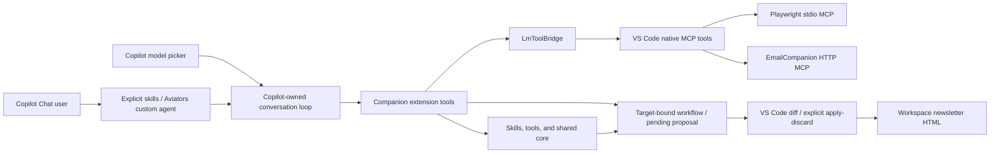
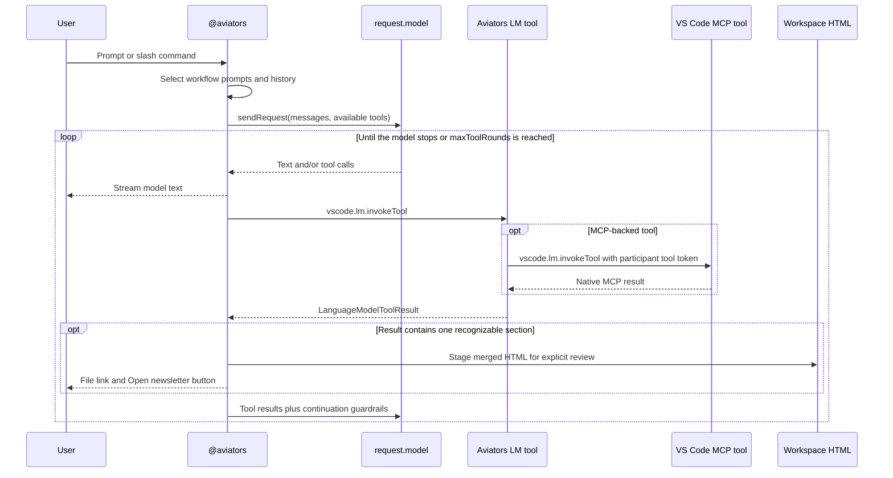
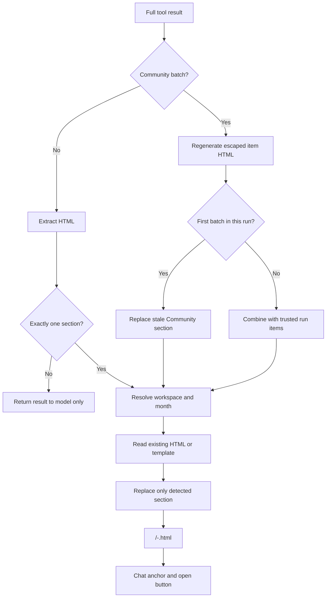

# Aviators Newsletter extension architecture

## Overview

Aviators Newsletter is an Agent Plugins 1.0 package plus a companion Visual Studio Code extension. It does not host an Express API, web UI, or model endpoint. The Copilot harness supplies the selected model, conversation loop, and context; plugin skills/agent instructions describe workflows; the companion supplies bounded operations, deterministic builders, native MCP services, trusted proposal state, and editor review.



## Runtime components

| Component | Location | Responsibility |
|---|---|---|
| Extension activation | `src/extension/extension.ts` | Register workflow/section tools, editor commands, shared output state, LinkedIn commands, MCP provider, and temporary Local participant. |
| Chat participant | `src/extension/participant.ts` | Temporary Local fallback only; not supported in the Copilot harness. |
| Language-model tools | `src/extension/toolRegistry.ts` | Register six workflow/editor tools, four deterministic section/date tools, and five source tools. |
| Workflow adapter | `src/extension/workflowRuntime.ts` | Bind explicit workspace targets and integrate trusted state with full tool-result staging. |
| Workflow state | `src/core/newsletterWorkflow.ts` | Enforce ordered section transitions independently of VS Code and chat history. |
| MCP bridge | `src/extension/lmToolBridge.ts` | Resolve MCP tool names from `vscode.lm.tools` and invoke them with the chat request's tool token. |
| Native MCP provider | `src/extension/mcpProvider.ts` | Programmatically define Playwright stdio and EmailCompanion HTTP servers. |
| Configuration/secrets | `src/extension/config.ts` | Read VS Code settings and store/read/delete the EmailCompanion API key through `SecretStorage`. |
| LinkedIn session | `src/extension/linkedinSession.ts` | Launch a headed Playwright MCP process, require manual sign-in/verification, save storage state, and validate cookies. |
| Output | `src/extension/output.ts` | Validate targets, serialize draft staging, protect proposal conflicts, and provide explicit diff/apply/discard and previews. |
| Core registry | `src/core/agent.ts` | Compose and dispatch the deterministic skills and MCP-backed tools. |
| Skills | `src/skills/` (`aceAviator.ts`, `productGroup.ts`, `communityNews.ts`, `dateWindow.ts`) | Provide deterministic newsletter section and date-window generation. |
| Tools | `src/tools/` (`emailTools.ts`, `playwrightTools.ts`) | Define MCP-backed EmailCompanion and Playwright operations. |
| Prompts | `src/prompts/` (`skillPrompts.ts`, `skillDetection.ts`, four `.md` files, `md.d.ts`) | Provide workflow-specific prompts, prompt detection, and anti-fabrication rules. |
| Shared core | `src/core/` (`newsletter.ts`, `newsletterRequest.ts`, `types.ts`, `mcpBridge.ts`, `calendarDate.ts`, `contentSafety.ts`) | Provide framework-independent kernel, composition, domain, and document utilities shared by skills and tools. |

## Activation and contributions

`package.json` declares:

- Temporary Local-only participant ID `aviators.newsletter`, exposed as `@aviators`.
- Fifteen registered language-model tools, including target/workflow, review and confirmed persist operations.
- Nine Command Palette commands, including pending proposal review/apply/discard and workflow status.
- Six `aviators.*` settings.
- MCP server definition provider ID `aviators.newsletter`.
- Extension entry point `dist/extension.cjs`.

`activate()` creates shared runtime objects and adds registrations to the extension context. Copilot invokes registered tools independently of the participant; result staging must therefore happen inside the workflow-aware tool adapter, not only the legacy chat loop.

## Plugin and Copilot request flow

`plugin\plugin.json` declares Agent Plugins 1.0. Six `plugin\skills\<name>\SKILL.md` files provide explicit namespaced slash entry points, and `plugin\com.github.copilot\agents\aviators.agent.md` supplies the persistent specialist role without a hardcoded model.

`scripts\build-plugin.mjs` materializes `dist\plugin` from those authored wrappers, a shared workflow reference, and canonical `src\prompts\*.md`. This avoids two hand-edited copies of detailed workflow guidance. Only the materialized/extracted package is installable; the source template's generated references are not complete.

The plugin intentionally does not duplicate the extension-owned Playwright/EmailCompanion definitions in `mcp.json`. Dynamic SecretStorage authentication, browser-state paths, and editor operations remain in the connected companion.

1. A skill creates/opens a template or begins a month/target-bound workflow with explicitly selected sections.
2. Copilot uses the registered tools and its normal context/approval/model loop.
3. Workflow-aware section tools receive the returned opaque `workflowId` and stage full validated results before any model-output truncation.
4. Trusted coordinator state enforces section order, pending Community batches, and stale/superseded continuation checks.
5. Status/review tools expose progress and the full accumulated target diff. Completed section commands reuse one pending proposal and its original conflict baseline; new workflow handles rebind its apply/discard guards. `draftSections` reports accumulated content separately from the current workflow's `stagedSections`.
6. Explicit `/aviators-newsletter:persist` invokes confirmed whole-draft apply/save; a known older handle selects the latest draft for its target. Without a target, multiple pending newsletters require a picker. Incomplete workflows block both chat and palette persistence. The palette uses the same proposal and safety checks.

The handle is not a durable chat identity or an authorization token. No private/proposed session API is assumed. State is in memory; reload invalidates handles. Client tools require the contributing editor to remain connected.

## Temporary Local fallback request flow

This legacy flow is retained until the small live Copilot acceptance checks in the README pass. It does not describe the new harness, and will be removed rather than maintained as a second permanent implementation.



### Model selection and token control

Only the temporary Local participant uses `ChatRequest.request.model`. The Copilot plugin does not call models at all; the host uses the user's selection. Neither path creates an independent model client.

Local counts/trims tokens and uses `aviators.maxToolRounds` (default 12, range 1-50). That setting does not limit the Copilot harness. Bounded companion operations retain cancellation/timeouts independently of the host conversation loop.

### Prompt authoring and bundling

Detailed workflow guidance is canonical Markdown in `src/prompts/aceAviator.md`, `communityNews.md`, `productGroup.md`, and `dateWindow.md`. Local still inlines it with esbuild's text loader. The plugin build copies it as discoverable references beside explicit `SKILL.md` wrappers. `.vscodeignore` excludes both source and `dist/plugin/**` from the companion VSIX; the separate plugin archive carries those resources.

### Command routing

- `/newsletter` creates/opens the template without loading generation workflows.
- `/ace` injects only the Ace Aviator workflow.
- `/product` injects date-window and Product Group workflows.
- `/community` injects date-window and Community workflows.
- `/preview` bypasses the model and opens an existing newsletter.
- A request without a command uses keyword-based skill detection.

The base and workflow prompts require real user/tool data and prefer omission or an explicit failure over fabricated content.

## Tool boundary

Six additional public operations are `beginNewsletterWorkflow`, `createNewsletterTemplate`, `getNewsletterWorkflow`, `reviewNewsletterWorkflow`, `persistNewsletterDraft`, and `openNewsletterPreview`. Generation builders and `scrapeLinkedIn` take an optional `workflowId`; plugin skills supply it to enable trusted staging/continuation. Without it, builders preserve standalone deterministic results for the Local adapter.

Existing domain/source operations:

| Registered tool | Execution |
|---|---|
| `aviators_computeDateWindow` | Local deterministic date-window skill. |
| `aviators_createAceAviator` | Local deterministic Ace Aviator HTML skill. |
| `aviators_createProductGroupNews` | Local deterministic Product Group HTML skill. |
| `aviators_createCommunityNews` | Local deterministic escaped Community batch skill. |
| `getEmailFromMCP` | EmailCompanion-backed source retrieval. |
| `aviators_scrapeLinkedIn` | Playwright-backed tool composed by the core registry. |
| `aviators_resolveRedirects` | Playwright-backed tool composed by the core registry. |
| `aviators_getTechCommunityBlogPosts` | Playwright-backed tool composed by the core registry. |
| `playwright_navigate` | Bounded external-page navigation through native Playwright. |

The four deterministic tools reuse section/date builders. The five source tools create an `LmToolBridge`, compose the core registry, and invoke native MCP through `vscode.lm.invokeTool`. Preserve the incoming opaque invocation token and reject a missing token; static API support is not proof of live nested-token/approval behavior in every harness.

The core registry composes lower-level EmailCompanion and Playwright operations from `src/tools/`, including `getEmailFromMCP`, `playwright_navigate`, `playwright_snapshot`, `playwright_click`, and `playwright_type`.

## Native MCP server providers

`AviatorsMcpServerDefinitionProvider` returns definitions only when `aviators.newsletter.enableMcpProvider` is enabled.

### Playwright

- Type: `McpStdioServerDefinition`.
- Command/arguments: `aviators.playwright.mcpCommand`.
- Default: Docker running `mcr.microsoft.com/playwright/mcp`.
- Added runtime arguments: `--isolated`, `--headless` when configured, and `--storage-state` only after extension global-storage `storage.json` exists. The default Docker command bind-mounts global storage and uses a container-visible storage path.
- Purpose: browser navigation, snapshots, LinkedIn activity retrieval, redirect resolution, and Tech Community retrieval.

Because the extension registers this definition programmatically, a workspace `.vscode/mcp.json` containing the same Playwright server would duplicate it and is not part of the repository.

### EmailCompanion

- Type: `McpHttpServerDefinition`.
- URI: `aviators.email.mcpEndpoint`; remote endpoints require HTTPS, while HTTP is accepted only for exact loopback hosts (`localhost`, `127.0.0.1`, or `::1`).
- Authentication: `X-API-Key` populated from VS Code `SecretStorage`.
- Purpose: retrieve the Ace Aviator email through the EmailCompanion MCP service.

The endpoint remains a normal VS Code setting. The API key is never stored in repository configuration.

## LinkedIn authentication state

The **Aviators: Sign in to LinkedIn** command starts a separate headed MCP process:

1. Create a persistent profile directory under extension global storage.
2. Convert the default Docker configuration to local `npx @playwright/mcp@latest`, because a visible browser is required.
3. Navigate to LinkedIn login.
4. Wait for the user to complete credentials and any manual LinkedIn verification.
5. Save `storage.json`.
6. Validate that a non-expired `li_at` authentication cookie is present on an exact LinkedIn domain.
7. Close the browser and MCP process.

The status command validates the saved state and offers to start sign-in when it is absent, invalid, or expired. Authentication challenges cannot be automated reliably; manual verification is an expected requirement.

## Workspace output flow

Ace Aviator and Product Group skills return `{ success, html, ... }`. Community calls return a structured `{ success, kind: "communityNewsBatch", items, batchHtml, hasMore, ... }` containing only the new escaped batch. `NewsletterOutputSession` handles the full tool result before any model-context truncation:

- `aceaviator`
- `productnews`
- `communitynews`



Target selection prefers explicit request references, then the active editor's workspace, then a single workspace, then a workspace picker. The configured output path must remain relative to the workspace. Writes are serialized per file to prevent overlapping updates.

Existing documents are split using section headings and merged with the built-in table-of-contents/template. `/preview` and the open command use `openTextDocument`/`showTextDocument` to open the HTML in an editor and never start a web server.

Community accumulation is extension-state-backed rather than model-backed. A workflow retains the generation record and structured items; its first successful batch replaces stale Community content, and later batches combine with trusted items. A newer generation invalidates old continuations, duplicates are removed, and HTML is regenerated under one heading. Prior newsletter HTML and internal generation state are never accepted as authority from the model. The external workflow handle refers to validated state, not caller-supplied generation metadata.

## Source layout

```text
src/
├── extension/
│   ├── extension.ts          activation and registrations
│   ├── participant.ts        Copilot Chat/model tool loop
│   ├── toolRegistry.ts       fifteen language-model tools
│   ├── workflowRuntime.ts    target-bound workflow adapter
│   ├── lmToolBridge.ts       VS Code MCP tool invocation bridge
│   ├── mcpProvider.ts        native MCP definitions
│   ├── linkedinSession.ts    headed sign-in/session validation
│   ├── output.ts             workspace HTML persistence
│   └── config.ts             settings and SecretStorage
├── skills/
│   ├── aceAviator.ts         Ace Aviator skill
│   ├── productGroup.ts       Product Group skill
│   ├── communityNews.ts      Community skill
│   └── dateWindow.ts         date-window skill
├── tools/
│   ├── emailTools.ts         EmailCompanion tool
│   └── playwrightTools.ts    Playwright-backed data tools
├── prompts/
│   ├── aceAviator.md         Ace Aviator workflow prompt
│   ├── communityNews.md      Community News workflow prompt
│   ├── productGroup.md       Product Group workflow prompt
│   ├── dateWindow.md         date-window workflow prompt
│   ├── md.d.ts               Markdown module declaration
│   ├── skillDetection.ts     pure prompt detection logic
│   └── skillPrompts.ts       Markdown prompt imports and assembly
└── core/
    ├── agent.ts              skill/tool registry and composition
    ├── newsletter.ts         document utilities/template
    ├── newsletterRequest.ts  request parsing
    ├── newsletterWorkflow.ts ordered workflow state
    ├── mcpBridge.ts          bridge contracts
    ├── mcpClientProtocol.ts  MCP client protocol types
    ├── calendarDate.ts       calendar/date domain helpers
    ├── contentSafety.ts      HTML and URL safety helpers
    ├── index.ts              shared exports
    └── types.ts              shared definitions
test/                         plain TypeScript test scripts
esbuild.mjs                   extension bundler
package.json                  VS Code manifest and scripts
```

## Build, test, and distribution

1. `npm run compile` runs `tsc --noEmit`, bundles the CommonJS extension, and materializes `dist\plugin`.
2. `npm run lint` runs ESLint across the repository.
3. `npm test` compiles/runs the Node suites and validates materialized plugin contracts.
4. `npm run package` invokes the VSIX prepublish compile and `vsce package --no-dependencies`.
5. `npm run package:plugin` archives the closed plugin asset list as a versioned `.tar.gz`.
6. Tagged GitHub releases publish matching versioned VSIX/plugin archives; no secrets, browser state, or unrelated sources are included.

The plugin and companion are installed separately. Static checks and fake source/state fixtures do not establish live Copilot discovery, nested MCP approvals, or real-service authentication; see the README's small manual acceptance checklist.
